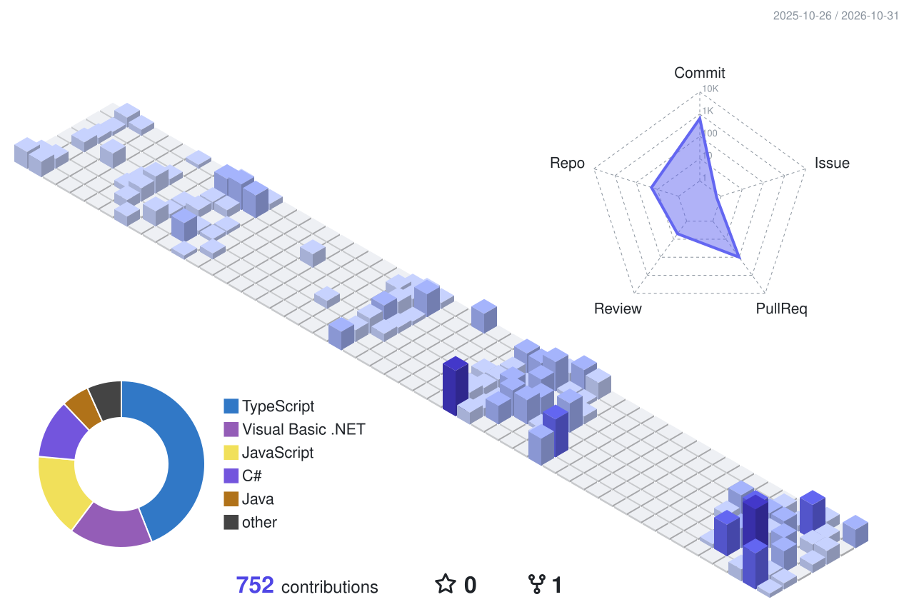

I build web apps end to end, from React frontends to .NET APIs, 
and sometimes games and compilers on the side.

<a href="mailto:jude.sangalang09@gmail.com">Email</a> &nbsp;·&nbsp; <a href="https://github.com/HeyJudo?tab=repositories">Projects</a>

 

 

### Now

- Building full-stack apps with **TypeScript + React** and **ASP.NET Core**
- Exploring **AI-driven development** and **agentic engineering**
- Student at PUP-CCIS

### Stack

### Featured

**[AsikaGo](https://github.com/HeyJudo/AsikaGo)** · [live](https://asika-go.vercel.app) 
Turns Philippine business registration into a step-by-step roadmap for micro-entrepreneurs. 
React · TypeScript · ASP.NET Core · Supabase · Docker

**[Space Battle](https://github.com/HeyJudo/space-battle)** 
A turn-based space duel written in C++ with raylib, compiled to WebAssembly to run in the browser. 
C++ · raylib · Emscripten

**[RouteLite](https://github.com/HeyJudo/Routelites)** 
Route optimizer for delivery riders in Metro Manila, using Dijkstra and branch-and-bound TSP. 
TypeScript · React Native · Algorithms

**[RREF Calculator](https://github.com/HeyJudo/RREF-Calculator)** · [live](https://rref-calculator.vercel.app) 
Solves matrices with Gaussian elimination and shows every step. 
React · TypeScript · math.js
